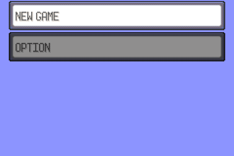
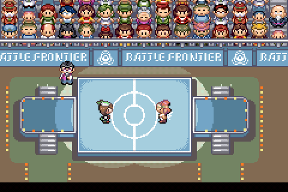
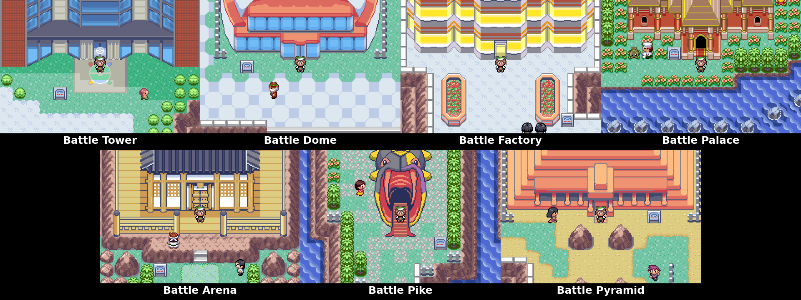
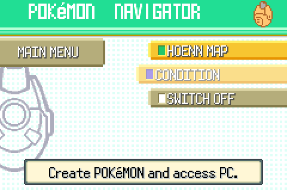
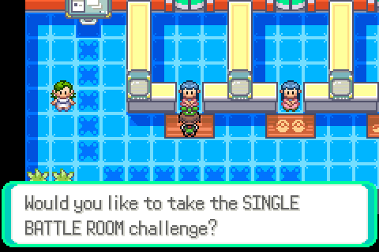

# Pokémon Emerald Battle Frontier

Start at the Battle Frontier. Use the Pokémon Lab to build your team, choose Normal or Hard challenges, and work toward all seven Frontier Symbols.

<p align="center">
  
  
</p>



## Features

<table>
  <tr>
    <th width="50%">Pokémon Lab</th>
    <th width="50%">Hard mode</th>
  </tr>
  <tr>
    <td valign="top">
      
      <p>Create a Pokémon in an open party slot or edit one already in your party.</p>
      <ul>
        <li>Choose species, nature, ability, level, and held item</li>
        <li>Edit IVs and EVs with live stat previews and useful presets</li>
        <li>Select legal level-up, TM/HM, tutor, egg, and pre-evolution moves</li>
        <li>Adjust each move's PP Up count, maximize eligible moves, or search for NONE to clear a slot</li>
        <li>Validate the completed build before saving it; B discards an unsaved draft</li>
      </ul>
    </td>
    <td valign="top">
      
      <p>Hard mode brings the Frontier's most demanding battles earlier in each challenge.</p>
      <ul>
        <li>Available at all seven Battle Frontier facilities</li>
        <li>Uses the strongest Frontier trainer pools</li>
        <li>Features earlier Frontier Brain encounters</li>
        <li>Tracks streaks, records, and progression separately from Normal mode</li>
      </ul>
    </td>
  </tr>
</table>

See the [player guide](docs/player-guide.md) for control details and defaults,
and [FEATURES.md](FEATURES.md) for the full list of gameplay changes.

## Install and play

Each release includes a BPS patch and `checksums.txt`. Apply the patch to
your own legally obtained copy of the supported game to create a playable ROM.
Releases do not include original or patched ROM files.

### Supported base ROM

Use an unmodified English-language US release of **Pokémon Emerald Version**.
No other revision, language, headered file, or previously modified ROM is
supported.

```text
Required base ROM SHA-1: f3ae088181bf583e55daf962a92bb46f4f1d07b7
```

### Apply the BPS patch

1. Download `pokemon-emerald-battle-frontier.bps` and `checksums.txt` from the
   [latest release](https://github.com/Michelleeby/pokemon-emerald-battle-frontier/releases/latest).
2. Open [Rom Patcher JS](https://www.marcrobledo.com/RomPatcher.js/). Patching
   is performed locally in your browser.
3. Select your verified Pokémon Emerald ROM as the ROM file. Select the
   downloaded `.bps` file as the patch, then apply it.
4. Save the patched ROM as `pokemon-emerald-battle-frontier.gba` and calculate
   its SHA-1:

```sh
sha1sum pokemon-emerald-battle-frontier.gba
```

Compare the result with the `SHA-1` value under **Patched production ROM** in
the `checksums.txt` file downloaded with the release.

The BPS patch checks that the selected base ROM is correct before applying
changes. If patching fails, check the base ROM's SHA-1 and confirm that the ROM
is unmodified.

## Report a bug

Search the [existing issues](https://github.com/Michelleeby/pokemon-emerald-battle-frontier/issues)
before opening a new one. Describe what happened and the steps needed to
reproduce it. Include the facility, challenge mode, and emulator or hardware
you were using so the problem can be checked under the same conditions. Do not
attach or link to ROM files.

## Build from source

This project uses the legacy `agbcc` toolchain. On Ubuntu or WSL2, install
the host dependencies, then build `agbcc` from the sibling checkout. Install
its compiler and libraries into this checkout before running `make`:

```sh
sudo apt-get update
sudo apt-get install -y build-essential binutils-arm-none-eabi libpng-dev
cd ../agbcc
./build.sh
./install.sh ../pokeemerald
cd ../pokeemerald
make -j2
```

Production ROM SHA-1: `82c1c06766be52b47c8f2c50153561208ba86128`

This is the current default `agbcc` source-build checksum. Release checksums
belong to the release artifact and may differ from older or newer source
builds.

This produces the development ROM, `pokeemerald.gba`. See
[INSTALL.md](INSTALL.md) for repository setup, build verification, and test
commands.

## Credits

- [pret/pokeemerald](https://github.com/pret/pokeemerald) and its contributors
  for the Pokémon Emerald decompilation on which this project is based.
- [Rom Patcher JS](https://github.com/marcrobledo/RomPatcher.js) by Marc
  Robledo for BPS patch creation and browser-based patching.

## Legal notice

Pokémon Emerald Battle Frontier is an unofficial, unaffiliated fan project.
Pokémon and Pokémon Emerald are trademarks of Nintendo, Creatures Inc., and
GAME FREAK inc. This project is not endorsed by or affiliated with those
companies.

No original or patched Pokémon Emerald ROM files are provided by this project.
Releases contain only a patch and checksum information.
