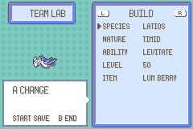
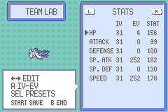
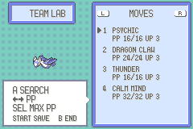
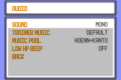
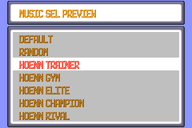
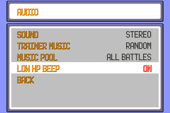

# Player guide

## Choose your avatar

At the start of a new game, press Up or Down to cycle through Brendan, May,
Red, Leaf, Ruby/Sapphire Brendan, Ruby/Sapphire May, Wally, and Steven. The
arrows show the controls, and the character preview updates as you cycle.
Press A to choose the displayed avatar and enter your name. Save through the
normal game menu to keep your choice after restarting.

## Pokémon Lab

Open the Pokémon Lab from the party menu or PokéNav to create or edit a party
Pokémon. Build sets species, nature, ability, item, and level. Stats sets IVs
and EVs and shows the resulting stats as you edit. Moves sets the four moves
and shows their current and maximum PP. On Stats, press A to switch between
IVs and EVs; the red flash marks the column Left and Right will edit.

  
  
  

| Page | Controls |
| --- | --- |
| Lab pages | L/R changes page; Up/Down selects a field or move slot |
| Build | A changes the selected field; Left/Right changes Level when Level is selected |
| Stats | A switches IV/EV editing; Left/Right changes the value; Select opens presets |
| Moves | A opens move search; Left/Right changes PP; Select applies Max PP |
| Main pages | Start saves the Lab draft; B ends the editor and discards it |

Selectors use A to confirm and B to go back. Start validates the Lab draft and
puts the Pokémon in your current party. Save through the normal game menu
afterward to keep the party and Audio preferences after restarting.

PP upgrades are free. On Moves, Left and Right lower or raise the selected
move's PP Up count from zero to three. Select applies Max PP to every
eligible move. Empty slots and Sketch cannot receive upgrades. Enter `NONE`
in move search to clear the selected slot.

Changing the maximum preserves PP already spent. A move at 5/10 PP becomes
11/16 after Max PP because the five spent PP remain spent. Repeating Max PP
leaves the remaining PP unchanged.

## Audio

  
  
  

Open Options → Audio to set Sound, Trainer Music, Music Pool, and Low HP Beep.
New games and existing saves without these settings use these defaults:

- Trainer Music: Default, which keeps the original music choice.
- Music Pool: Hoenn + Kanto trainer and boss themes.
- Low HP Beep: Off.
- Sound: the saved Mono/Stereo value.

Trainer Music lets you keep Default, choose a named track, or use Random for
regular trainer battles. Music Pool controls the available tracks. Hoenn
contains the Hoenn trainer and boss themes, Hoenn + Kanto adds the
FireRed/LeafGreen trainer and boss themes, and All Battles adds the remaining
battle themes. Frontier Brains and other special battles keep their original
music. If you change the pool and it no longer includes your chosen track,
Trainer Music returns to Default.

Press Select to preview a named track, A to choose it, or B to cancel.
Leaving the picker restores the music that was playing before the preview.
Random avoids playing the same track twice in a row within the current
session when another track is available.

Press B to return to Options, then leave Options to apply the preferences.
Save through the normal game menu to keep them after restarting.

Low HP Beep controls the repeating red-HP alert. Turning it off stops an active
alert; turning it on restores the original warning.
